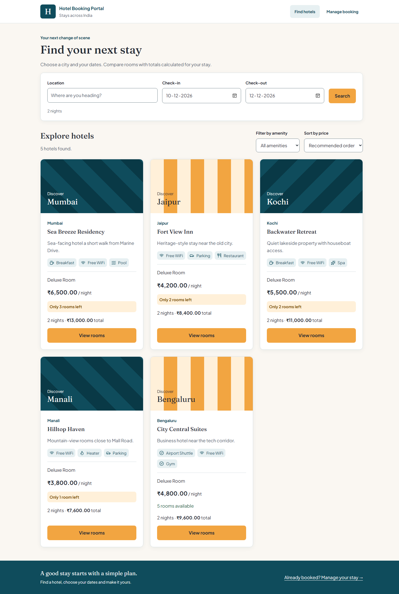
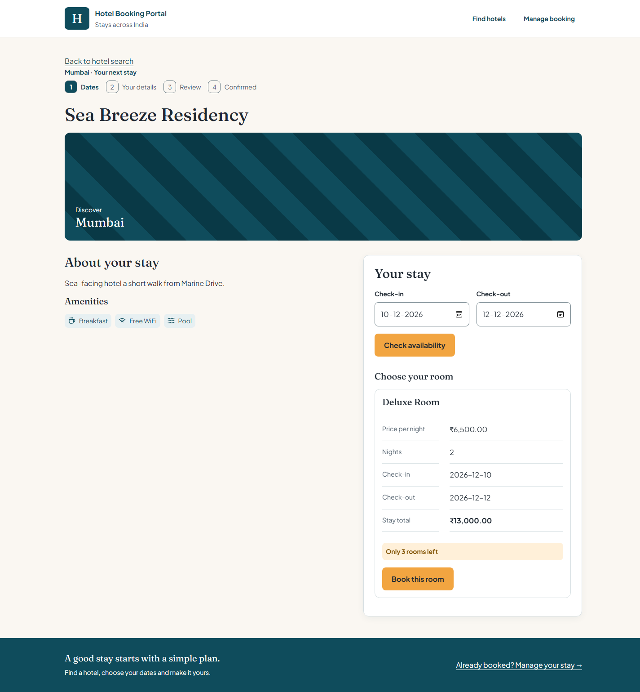
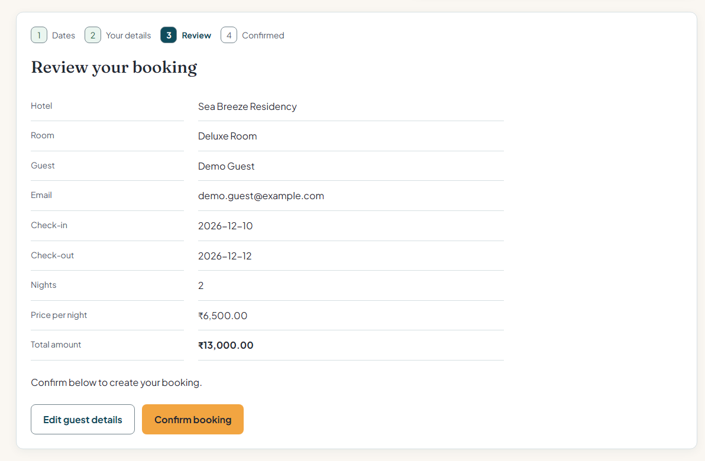
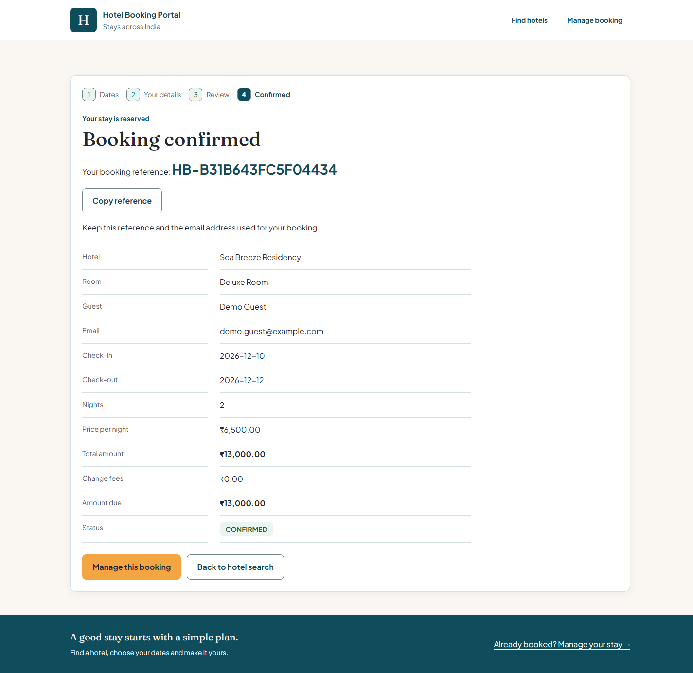
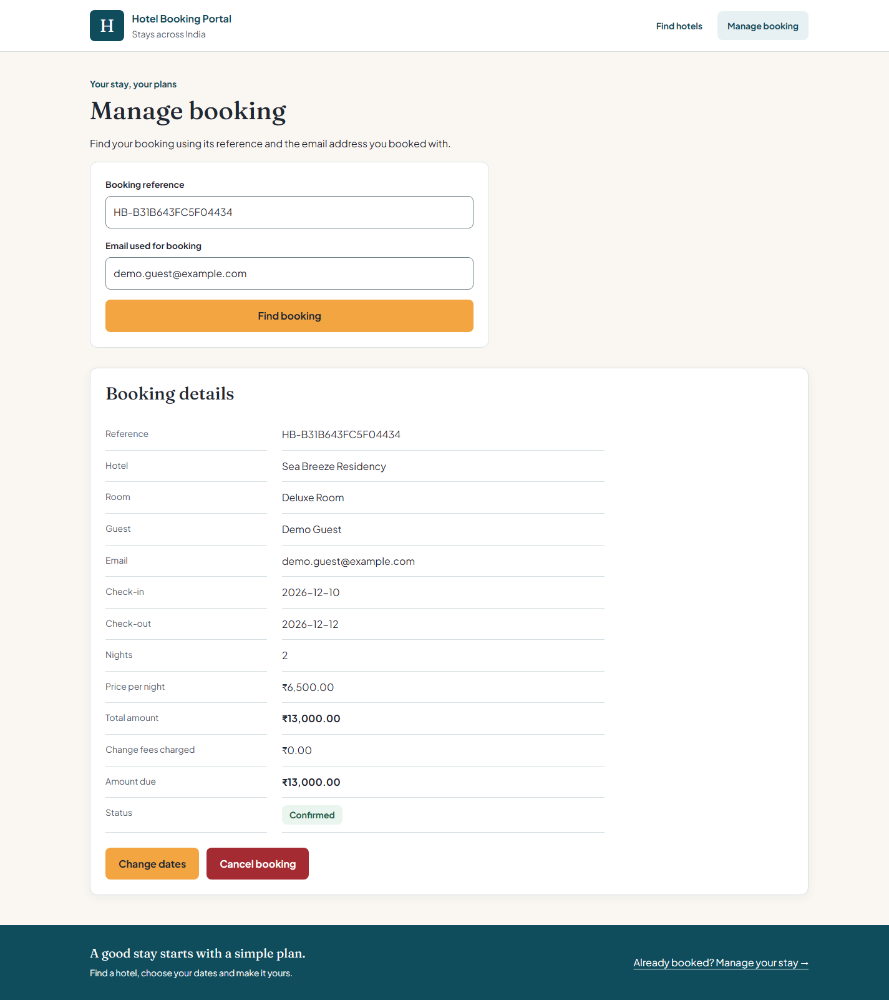
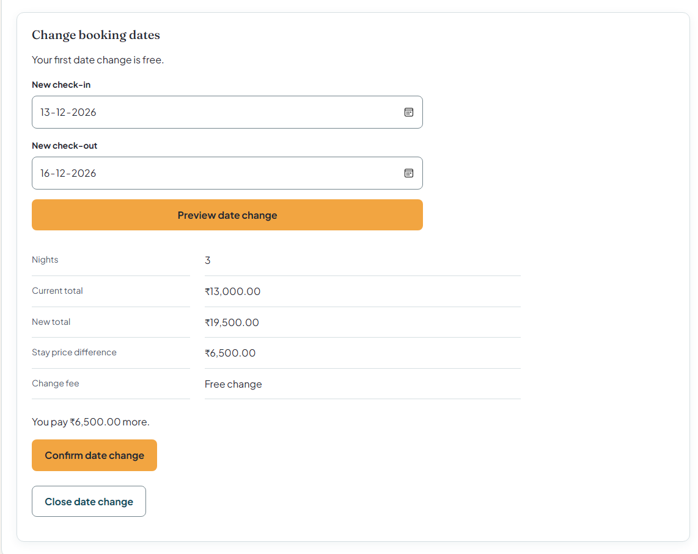
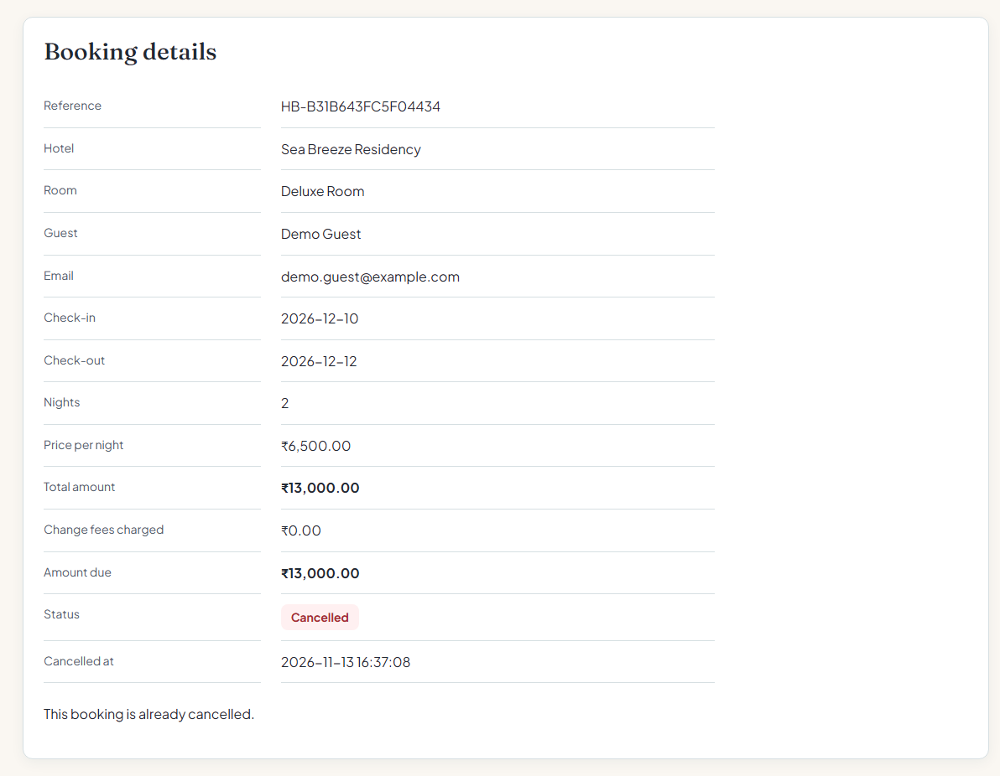

# Hotel Booking Portal

A full-stack hotel search and booking portal built with React, Spring Boot, and MySQL. It includes five seeded hotels, date-aware availability, a backend-calculated total shown before confirming, booking confirmation with a unique reference, booking lookup and cancellation, amenity filtering and price sorting, and a date-change flow that lets a guest move a confirmed booking to new dates without cancelling it.

## Prerequisites

- Java 21
- Maven 3.6.3 or later
- Node.js 20.19+ or 22.12+ and npm
- MySQL 8.0.16 or later (the schema uses `CHECK` constraints)

Developed with Java 21.0.7 LTS and MySQL Community Server 8.0.45.

## Run locally

1. Start MySQL and create the database and sample data by running `db/schema.sql` once. Unlike a Flyway setup, this project keeps the schema in a hand-written script and the application never creates or alters tables, so this step must be done before the backend starts.

   ```powershell
   mysql.exe -u your-local-mysql-user -p -e "source db/schema.sql"
   ```

   Check it worked:

   ```powershell
   mysql.exe -u your-local-mysql-user -p -e "SELECT id, name, location FROM hotel_booking.hotel;"
   ```

   Five hotels should be listed. The script is written for a fresh database and is not safe to run twice; to start again, run `DROP DATABASE hotel_booking;` first. The two `db/phase9-*.sql` scripts are only for a database created from an older version of the schema — a fresh setup does not need them.

2. Configure backend connection details in your shell. Keep real credentials in environment variables; do not commit them. Spring Boot does not read `.env` files, so `.env.example` lists the variable names only.

   PowerShell example:

   ```powershell
   $env:DB_URL = 'jdbc:mysql://localhost:3306/hotel_booking?allowPublicKeyRetrieval=true&useSSL=false'
   $env:DB_USERNAME = 'your-local-mysql-user'
   $env:DB_PASSWORD = 'your-local-mysql-password'
   ```

3. Start the API from `backend/`:

   ```powershell
   mvn spring-boot:run
   ```

   It listens on `http://localhost:8080`. Open `http://localhost:8080/api/hotels` to confirm it returns the five sample hotels as JSON. The application runs with `spring.jpa.hibernate.ddl-auto=validate`, so it checks that the entities match the tables at startup but never modifies them. A schema validation error at startup means the database was not created from the current `db/schema.sql`.

4. In another terminal, start the frontend from `frontend/`:

   ```powershell
   npm.cmd install
   npm.cmd run dev
   ```

   Open `http://localhost:5173`. The port is fixed, because the backend allows CORS requests only from that origin; if the port is busy, Vite stops rather than moving to another one. The frontend calls `http://localhost:8080/api` by default. Set `VITE_API_BASE_URL` only when using a separately hosted API; it can be added to an ignored `frontend/.env.local` file.

### Sample data

| Hotel | Location | Price per night | Rooms |
|---|---|---|---|
| Sea Breeze Residency | Mumbai | ₹6,500 | 3 |
| Fort View Inn | Jaipur | ₹4,200 | 2 |
| Backwater Retreat | Kochi | ₹5,500 | 2 |
| Hilltop Haven | Manali | ₹3,800 | 1 |
| City Central Suites | Bengaluru | ₹4,800 | 5 |

The hotels and prices are invented. Room counts are deliberately small so the sold-out case is easy to demonstrate: Hilltop Haven has one room, so booking it twice for overlapping dates shows the sold-out path immediately.

## Project flow

### Approach taken to complete the assessment

I started with the MySQL schema and sample hotel data, since the booking rules depend on how availability is stored. I decided not to keep a separate availability table or a counter column: availability is calculated from the bookings themselves, so there is only one source of truth and the numbers cannot drift apart.

I then built the Spring Boot API in layers — entities matching the schema, repositories with the overlap queries, services holding the booking rules, and thin controllers that only map HTTP to service calls. Date validation, availability, pricing and the change-fee rule each live in their own small class so they can be tested on their own. Controllers never return entities; every response is a DTO record.

With the API working, I connected the React interface and completed the guest flow: browse or search stays, pick dates and see availability, enter guest details, review the backend-calculated total, confirm, and later look the booking up to cancel it or move it to new dates. Error handling went in early rather than at the end — one exception handler produces a single JSON error shape, and one API helper on the frontend parses it, so every screen can show field-level messages next to the right input.

I worked in small phases and committed each one separately, so the git history shows the project being built up rather than arriving in one commit.

### Key assumptions made

Each booking reserves one room unit. A guest who needs two rooms makes two bookings, and each hotel has a single room category, although the `room_type` table allows more later.

A stay is the half-open range `[check-in, check-out)`. The check-out day is not counted as an occupied night, so another guest can check in that day and back-to-back stays do not conflict.

Rooms within a category are interchangeable; a booking reserves capacity rather than a specific room number. "Today" is the date on the server, and the application is assumed to run in the same time zone as its guests.

For this demo, guests retrieve bookings with the booking reference and the email address used at booking — there are no user accounts. A booking keeps the nightly price it was made at, even if the hotel price changes later or the guest moves the dates. No payment is processed: totals and change fees are calculated, stored and displayed only.

### Challenges faced and how they were addressed

**Two guests booking the last room.** This was the main one. The booking method is a single `@Transactional` service method whose first action locks the `room_type` row with `SELECT ... FOR UPDATE`. It then counts overlapping confirmed bookings and inserts, all while holding the lock, so a second request for the same room type waits, re-reads committed data, and correctly gets `409 SOLD_OUT`. The method has to be `public` and called from the controller — a different Spring bean — because calling it from inside the same class would bypass the proxy and silently skip the transaction and the lock. The server also calculates the total itself from the stored room price and stay length, so it never trusts an amount sent by the browser.

**Dates shifting by a day.** My first instinct on the frontend was to turn the date input's value into a JavaScript `Date`. In India (UTC+5:30) converting through UTC moves the date back a day, so a stay could be sent to the API starting the day before the guest chose. I fixed it by treating dates as plain `YYYY-MM-DD` strings end to end and never constructing a `Date` for anything sent to the API. The one helper that does date arithmetic (the check-out input's minimum) works on year/month/day parts in local time, and it has unit tests covering month ends, year ends and leap years.

**A booking blocking its own date change.** When I added the date-change feature, extending a one-room stay by a night was always refused. The new dates overlap the booking's own current dates, so it was counting itself as a competing booking. The availability query used by a date change takes the booking's id and excludes that row, since the guest already holds the room.

**Schema validation at startup.** Because Hibernate runs in `validate` mode against a hand-written schema, small mismatches stop the application rather than being silently patched. The `status` ENUM column and the composite primary key on `hotel_amenity` both needed the mapping to be written explicitly. I kept `validate` rather than switching to `update`, so the application can never alter the tables by surprise.

### Additional enhancements or improvements with more time

**Confirmation emails.** The reference is only shown on screen. Sending it by email on booking, date change and cancellation would make the lookup flow realistic, and a one-time link would be a better identity check than reference plus email — which today also travels in the URL of the two `GET` booking endpoints and so can appear in server logs.

**Flexible dates assistance:** Customer says “cheapest nearby weekend”. Backend finds all possible windows. Model just sorts and describes windows. Extends date changing capability . Can be added to date feature


## Surprise element: change booking dates without cancelling

### 1. What the feature does

On the **Manage booking** page guests can click on Change dates. They will be able to update their check in/out date and view a summary of the changes. This will show how many nights they have booked, their new total, how much this differs from their current total, the cost of changing their booking (or free change). It will also say:

"You pay X more", "You pay X less" or "Your total stays the same".

Once they have clicked confirm their booking will be updated however the booking reference will stay the same. If the new dates are fully booked they will see "The new dates are sold out. Your booking is unchanged," and no updates will be made.

### 2. Why I chose it

However, if changes are made to the plan, if we just have the basic functionality and need to change the dates of a guest, there are issues. If they cancel their booking and re-book they could lose their room completely as by the time they have cancelled, someone may have booked the new dates or the room could be full. They also lose the rate they had agreed on as they will have to pay today’s price to book. Finally, they have a different reference.

Changing the date of a booking solves an actual issue. It is a small task which can be completed fully. We can also use our existing logic from availability and blocking.

### 3. How I implemented it
**Backend**

Two endpoints. `GET /api/bookings/{reference}/date-change-preview` is read-only and returns `available`, `nights`, `oldTotal`, `newTotal`, `difference`, `changeFee` and `netChange`, so it is safe to call every time the guest edits a date. `PUT /api/bookings/{reference}/dates` performs the change.

The change runs in one transaction in `BookingService.changeDates`: find the booking by reference and email and lock its row (404 if there is no match), reject it if it is not `CONFIRMED` (409), validate the new dates with the same rules as a new booking, lock the room type row exactly as booking does, then count overlapping confirmed bookings for the new dates **excluding this booking's own id**. If no room is free it returns 409 and changes nothing. Identical dates are treated as a no-op. Only once every check has passed does it update the dates and total, add any fee to `change_fee_total`, and increment `date_change_count`. No field is touched before that point, so a failure at any step leaves the booking exactly as it was.

The new total is `new nights × booking.price_per_night`, using the price stored on the booking rather than the hotel's current price, so the guest keeps the rate they agreed to and a date change cannot be used by either side to change the price.

The fee rule is a single pure method, `ChangeFeePolicy.calculate(currentCheckIn, today, configuredFee, successfulChanges)`: the first successful change of a booking is free whenever it happens; later changes made two or more days before the current check-in are free; later changes made inside that window cost a flat fee read from configuration (`booking.change-fee=500.00`). The intent is to be generous once, free when the hotel has notice, and charge only for repeated last-minute changes. Because it takes no database or clock dependency, it is tested directly with a table of cases including the exact two-day boundary. Previews, failed changes and identical-date submissions never consume the free change or add a fee.

Fees are stored in their own column rather than folded into `total_amount`, which always means `nights × price_per_night`. If fees were mixed in, the next date change would recalculate the total and either wipe them out or count them twice. The API returns both, plus `amountDue = totalAmount + changeFeeTotal`.

**Frontend**

`DateChangeForm.jsx` renders two date inputs and a **Preview date change** button. The preview response is shown as separate lines for the new total, the stay-price difference and the fee, and the **Confirm date change** button appears only when the new dates are available. Editing either date clears the previous preview, so the guest can never confirm numbers belonging to different dates.

### 4. Note

No payment is processed anywhere in the application. The price difference and the change fees are calculated, stored and displayed as amounts owed; nothing is collected or refunded.

## View saved bookings in MySQL

Bookings are stored in the `hotel_booking.booking` table. Connect to the same local MySQL server with MySQL Workbench (commonly `localhost:3306`) and run:

```sql
USE hotel_booking;
SELECT id, booking_reference, guest_name, guest_email, room_type_id,
       check_in, check_out, price_per_night, total_amount,
       change_fee_total, date_change_count, status, created_at, cancelled_at
FROM booking
ORDER BY created_at DESC;
```

Confirmed and cancelled bookings both remain in this table; the `status` column shows which is which. A cancellation releases availability by setting the status to `CANCELLED` and stamping `cancelled_at` — the row is never deleted, and the availability query simply stops counting it.

To see availability the way the backend calculates it, for room type 1 over a given stay:

```sql
SELECT rt.total_rooms - COUNT(b.id) AS available_rooms
FROM room_type rt
LEFT JOIN booking b
       ON b.room_type_id = rt.id
      AND b.status = 'CONFIRMED'
      AND b.check_in < '2027-01-13'
      AND b.check_out > '2027-01-10'
WHERE rt.id = 1
GROUP BY rt.id, rt.total_rooms;
```

## API overview

- `GET /api/hotels?location=&checkIn=&checkOut=` — browse and search stays; all parameters are optional, but the two dates must be given together. With dates, each room type also returns `availableRooms` and `totalAmount`.
- `GET /api/hotels/{id}?checkIn=&checkOut=` — hotel details, amenities, and room availability for the dates.
- `POST /api/bookings` — create a one-room booking; the server calculates the amount and returns a 19-character reference such as `HB-3F9A1C0D7B2E4A61`.
- `GET /api/bookings/{reference}?email=` — retrieve a booking by its reference and the email used at booking (reference matching ignores case and surrounding spaces).
- `POST /api/bookings/{reference}/cancel` — cancel a booking; the email goes in the body.
- `GET /api/bookings/{reference}/date-change-preview?email=&checkIn=&checkOut=` — price a date change without applying it.
- `PUT /api/bookings/{reference}/dates` — move a confirmed booking to new dates.

Every failure uses the same JSON shape, so the frontend needs only one parser:

```json
{
  "status": 409,
  "code": "SOLD_OUT",
  "message": "No rooms are available for the selected dates.",
  "fieldErrors": {}
}
```

`400 VALIDATION_ERROR` names each bad field in `fieldErrors`; `404 NOT_FOUND` covers an unknown hotel or URL and a reference and email that do not match, so the API never reveals which references exist; `409` is `SOLD_OUT`, `ALREADY_CANCELLED` or `BOOKING_NOT_CONFIRMED`. Spring's own errors, such as an unknown route or a malformed date, are mapped into the same shape.

## Build and tests

Run the frontend build and date-helper tests from `frontend/`:

```powershell
npm.cmd run build
npm.cmd test
```

Run the backend tests from `backend/`:

```powershell
mvn test
```

The backend tests need no MySQL server and no environment variables — they run on an in-memory H2 database with tables created from the entities. They cover the nights and total calculation and the stored price snapshot (with Mockito mocks), past and inverted dates, overlap detection including back-to-back stays that must not conflict, booking beyond capacity, cancellation restoring availability, and the date-change rules: recalculation with the stored price, extending a one-room stay, sold-out changes leaving the booking untouched, cancelled bookings being refused, and the change-fee boundaries.

### API documentation

An OpenAPI 3 description of every endpoint is served at `http://localhost:8080/openapi.json` while the backend is running. There is no Swagger UI bundled in the application; paste that document into [editor.swagger.io](https://editor.swagger.io) to browse the endpoints, parameters and example responses.

See [DESIGN.md](DESIGN.md) for the architecture, schema and constraints, API design, booking rules, trade-offs, the simultaneous-booking walkthrough, and the full list of limitations.


## AI assistance

I used AI tools while building this project and want to be open about it. I wrote the database schema and the phase-by-phase plan and business rules in `AGENTS.md` myself, then used **OpenAI Codex** to implement one phase at a time, reviewing, running and committing each phase. I used **Claude** for planning, for reviewing the code against the assignment, and for the first drafts of this README and DESIGN.md, which I then revised.

## Demo recording and screenshots

Screenshots from the running application are stored in `docs/screenshots/`.
The booking uses the synthetic guest **Demo Guest** (`demo.guest@example.com`)
and was cancelled after capture to release the room.

### Hotel search

Search results with dates, room availability and backend-calculated totals.



### Hotel details

Hotel amenities, selected dates and available room options.



### Booking review

Guest details and the backend-calculated total before confirming.



### Booking confirmation

The booking reference, saved stay details and amount due.



### Manage booking

Booking lookup, confirmed status, change fees and available actions.



### Date-change preview

The new total, price difference and free first change shown separately.



### Cancelled booking

The cancelled demo booking; its room is available again.



Approximate time spent: **13 hours** <!-- TODO: fill in before submitting -->
